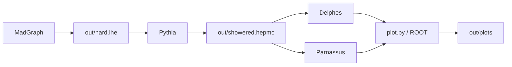
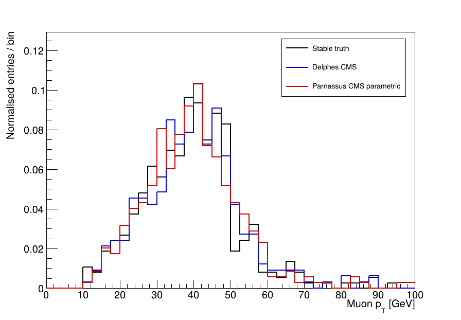

# Detector-chain learning

[简体中文](README.zh-CN.md)

A manual **MadGraph → Pythia → Delphes / Parnassus** tutorial. Follow one small simulation through its files, understand what each package does, and change one setting at a time. A single ROOT plotting script handles the repetitive analysis.

**Start with the [handbook](handbook.md).** On a new machine, follow [setup.md](setup.md) first. The project has its own Python 3.12 environment and toolchain; the [SMEFTsim learning tutorial](https://github.com/RuneTan/smeftsim-learning) is a teaching reference, not a prerequisite.

The benchmark is 200 SM Drell–Yan events, `p p > mu+ mu-`, at 13 TeV. Delphes and Parnassus read the **same HepMC3 file**. Parnassus uses its CPU parametric CMS model; this exercise does not train or validate a neural detector model.



| File or directory | Role |
|---|---|
| [handbook.md](handbook.md) | Package calls, inputs and outputs, and a one-setting exercise |
| [setup.md](setup.md) | Standalone Linux installation of Python, ROOT and the toolchain |
| [dependencies.md](dependencies.md) | System, environment and package dependencies |
| `env.sh` | Paths for the current terminal; no shell-profile or global Python changes |
| `hepmc_io.py` | Pythia/HepMC adapter with stable-particle and momentum checks |
| `plot.py` | Read detector outputs, check event counts, and make ROOT plots and a count summary |
| `bin/root-config` | Correct the pinned ROOT wheel's compiler paths without changing ROOT |
| `requirements.lock.txt` | Pinned Python dependencies, including ROOT and CPU PyTorch |
| `config` | Pythia and Parnassus settings; copy the Delphes card from upstream during setup |
| [examples](examples/README.md) | Reference figures, validation records and plotting histograms |
| `tools`, `work/dy`, `out` | Local software, exported MadGraph process and run outputs; not distributed |
| [SOURCES.md](SOURCES.md) | Upstream tutorials and pinned versions |
| [THIRD_PARTY_NOTICES.md](THIRD_PARTY_NOTICES.md) | Software attribution, scientific references and license scope |

Clone the small teaching repository inside Linux, then follow the installation guide:

```bash
git clone https://github.com/RuneTan/detector-learning.git ~/detector-learning
cd ~/detector-learning
```

Software downloads, `.venv`, raw runs and maintenance logs are excluded. New users generate the raw inputs themselves; the repository includes only small reference results.



The figure is normalized within its plotted range and compares shapes, not absolute cross sections. The [example guide](examples/README.md) explains the counts and limitations.

## Existing-machine notes

The prepared installation is `/home/smeft/detector-learning` in a WSL distribution named `SMEFTsim`. Its own Python 3.12.12 environment includes ROOT/PyROOT, Pythia and Parnassus; MadGraph and Delphes also live inside this project. It uses no interpreter, package or shared library from `/home/smeft/smeftsim`.

On that machine, double-click `enter-linux.cmd`, start at handbook section 2, and use `python plot.py` if both detector outputs already exist. The launchers contain machine-specific distribution, user and directory names; edit them before use elsewhere. Native Linux does not need them.

The projects share Ubuntu and its compilers. The Windows file `smeftsim/vm/SMEFTsim/ext4.vhdx` holds that entire Linux filesystem, including both projects: **do not delete it**. The Windows tutorial folder contains reading copies and launchers; calculations run in Linux. See [dependencies.md](dependencies.md).

This is a learning and interface-validation project. [Third-party notices](THIRD_PARTY_NOTICES.md) document attribution, scientific references and license boundaries; no project-wide reuse license has been selected.
