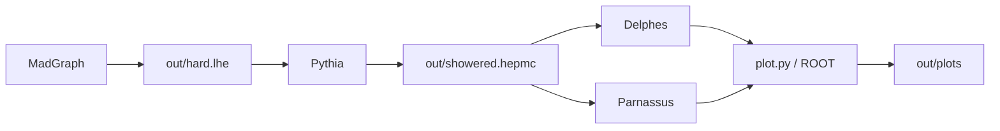

# 探测器模拟链学习

[English](README.md)

一份手动完成 **MadGraph → Pythia → Delphes / Parnassus** 的教程。沿着文件认识一个小型模拟闭环，理解每个包的作用，再逐项改变设置。重复性的分析与画图交给一个 ROOT 脚本。

**从 [handbook](docs/handbook.zh-CN.md) 开始。** 新机器先按 [setup](docs/setup.zh-CN.md) 安装。本项目有独立的 Python 3.12 环境和工具链；[SMEFTsim 学习教程](https://github.com/RuneTan/smeftsim-learning) 是教学参考，不是安装前提。

基准是 13 TeV 下 200 个 SM Drell–Yan 事件，`p p > mu+ mu-`。Delphes 和 Parnassus 读取**同一份 HepMC3 文件**。Parnassus 使用 CPU 参数化 CMS 模式；本练习不训练或验证神经探测器模型。



教程与说明集中在 [docs](docs/README.md)。

| 文件或目录 | 用途 |
|---|---|
| [handbook](docs/handbook.zh-CN.md) | 包的调用、输入输出和单设置练习 |
| [setup](docs/setup.zh-CN.md) | 在 Linux 独立安装 Python、ROOT 和工具链 |
| [dependencies](docs/dependencies.zh-CN.md) | 系统、环境和软件包的依赖关系 |
| `env.sh` | 只设置当前终端路径，不改 shell 配置或全局 Python |
| `hepmc_io.py` | Pythia/HepMC 适配层，核对稳定粒子和四动量 |
| `plot.py` | 读取探测器输出，检查事件数，生成 ROOT 图和计数 |
| `bin/root-config` | 修正固定 ROOT wheel 的编译路径，不改 ROOT |
| `requirements.lock.txt` | 锁定 Python 依赖，包括 ROOT 和 CPU PyTorch |
| `config` | Pythia、Parnassus 设置；Delphes 卡在安装时从上游复制 |
| [examples](examples/README.zh-CN.md) | 参考图、验证记录和直方图 |
| `tools`、`work/dy`、`out` | 本地软件、MadGraph 过程和运行产物，不随仓库分发 |
| [SOURCES](docs/SOURCES.zh-CN.md) | 上游教程和固定版本 |
| [第三方声明](docs/THIRD_PARTY_NOTICES.zh-CN.md) | 软件署名、科学引用和许可范围 |

在 Linux 中克隆小型教学仓库，再按安装指南操作：

```bash
git clone https://github.com/RuneTan/detector-learning.git ~/detector-learning
cd ~/detector-learning
```

软件、`.venv`、原始运行文件和维护日志不上传。新读者自行生成原始输入，仓库只附小型参考结果。


图在绘图区间内归一化，用于比较形状，不表示绝对截面。计数和限制见 [示例说明](examples/README.zh-CN.md)。

## 当前机器说明

现有安装位于 WSL 发行版 `SMEFTsim` 的 `/home/smeft/detector-learning`。其独立 Python 3.12.12 环境包含 ROOT/PyROOT、Pythia 和 Parnassus，MadGraph 与 Delphes 也在项目内；运行时不读取 `/home/smeft/smeftsim` 的解释器、包或共享库。

本机双击 `enter-linux.cmd`，从手册第 2 节开始。已有两份探测器输出时运行 `python plot.py` 即可。入口中的发行版名、用户名和目录属于本机，其他机器使用前需要修改；原生 Linux 不需要这些入口。

两个项目共享 Ubuntu 和编译器。Windows 的 `projects/smeftsim/vm/SMEFTsim/ext4.vhdx` 承载整个 Linux 文件系统，包含两个项目，**不能删除**。Windows 教程目录只保留 README 和启动入口，文档与计算均在 Linux，详见 [依赖关系](docs/dependencies.zh-CN.md)。

这是学习与接口验证项目。署名、科学引用和许可边界见 [第三方声明](docs/THIRD_PARTY_NOTICES.zh-CN.md)；自有文件尚未选择统一再使用许可证。
