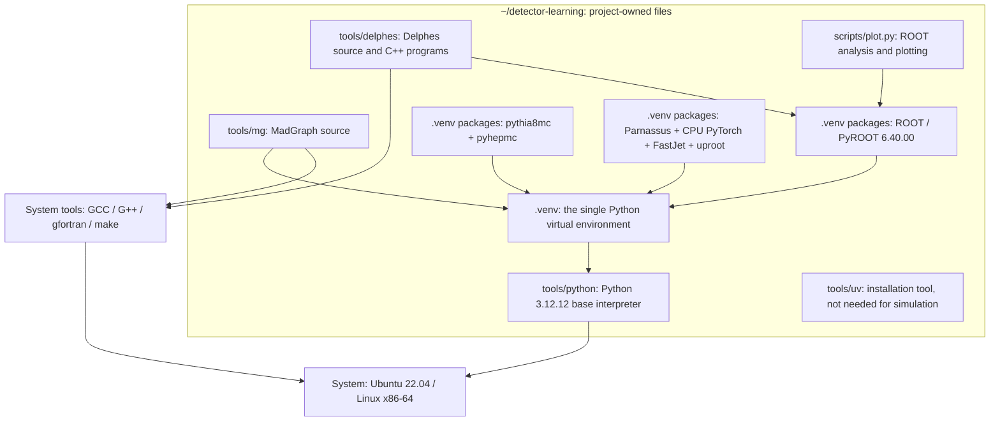

# Dependencies and environment isolation

[简体中文](dependencies.zh-CN.md)

The tutorial installs one project-owned Linux environment. Python, scientific packages, MadGraph and Delphes live inside `~/detector-learning`. Ubuntu and system compilers are provided by Linux. Installing the separate SMEFTsim tutorial is not required.

## 1. The detector project alone

Arrows mean “requires for execution or building”, rather than simulation data flow:

Parnassus writes ROOT-format files through `uproot` and does not itself require PyROOT. ROOT provides the Delphes build libraries and analysis interface here. Installing it in the same environment means you always use the same `python`.

Delphes includes C++ FastJet/Tcl source; Parnassus uses the Python FastJet wheel. They serve separate backends, so there is no need to compile a third FastJet installation.

## 2. Systems, environments and packages

| Layer | Actual location | Role |
|---|---|---|
| Linux system | Ubuntu 22.04, native or in WSL 2 | Base libraries, terminal and access to the Linux kernel; no particular distribution name or Linux username is required |
| System tools | `/usr/bin` and related paths | Git, download tools and compilers, available to both projects |
| Base Python interpreter | `tools/python/cpython-3.12.12-linux-x86_64-gnu` | Project-local Python used by `.venv`; do not delete it after copying only `.venv` |
| Python environment | `.venv` | Isolates third-party Python packages; does not contain system compilers |
| Python packages and prebuilt libraries | `.venv/lib/python3.12/site-packages` | ROOT, Pythia, HepMC, Parnassus, PyTorch and others; see the [lock file](../requirements.lock.txt) |
| Source and compiled programs | `tools/mg`, `tools/delphes` | Python drives MadGraph's generated Fortran; Delphes compiles to C++ programs |
| Installation tool | `tools/uv/bin/uv` | Downloads Python, creates the environment and installs dependencies |
| Graphics compatibility libraries | `.venv/local-libs` | libSM/libICE extracted from Ubuntu packages for this project's ROOT |
| Settings and products | `config`, `work/dy`, `out` | Cards, generated process and simulation outputs; these are data, not environments |

`scripts/env.sh` sets these paths for the current terminal; `source .venv/bin/activate` displays the environment in the prompt. MadGraph, Pythia, Parnassus and ROOT all use `python`, without switching between Python 3.10 and 3.12.

Commands use paths relative to the project root. `tools/mg` contains MadGraph, `work/dy` contains the exported process and `out` contains generated data. The setup and handbook create these directories explicitly.

## 3. Why Python 3.12 can serve the whole project

The pinned Parnassus version requires Python `>=3.12,<3.13`; [ROOT 0.1a12](https://pypi.org/project/ROOT/0.1a12/) provides a matching CPython 3.12 Linux wheel. Extension packages must match the interpreter, so this project installs that wheel separately rather than pointing at Python 3.10's ROOT directory.

The supplied 200-event SM LO dimuon reference was generated with MadGraph 2.9.27 using Python 3.12. Older source may emit `SyntaxWarning: invalid escape sequence`; suppressing such warnings does not establish that a run succeeded. Other models, NLO calculations and plugins require separate validation.

Build Delphes against this project's ROOT as described in [setup](setup.md). Verify its library paths with `ldd`; changing documentation or a Python command does not relink a binary.

## 4. Keeping projects separate

Use a separate directory and environment for each project. Open a new Linux terminal when switching projects, then source that project's environment settings. Do not borrow another project's Python packages or shared libraries.

A second Linux installation is unnecessary. Windows readers can use their installed WSL 2 Ubuntu; native Linux readers use their existing system. WSL manages the virtual disk containing the Linux filesystem, so do not move or delete its disk file as part of ordinary project cleanup.

## 5. Validated scope

The recorded reference run completed MadGraph → Pythia → both detector backends → ROOT plotting, with 200 events per stage. Same-input/same-seed replay within each backend gave equal muon pT values. Stable-particle four-momenta and production positions were preserved during conversion.

[Reference records](../examples/validation.json) document the versions and results. They describe a recorded run, not the state of your computer. Complete the installation checks and handbook yourself. The full setup has not yet been replayed on a separate clean machine; the physics comparison remains a small-sample interface exercise.