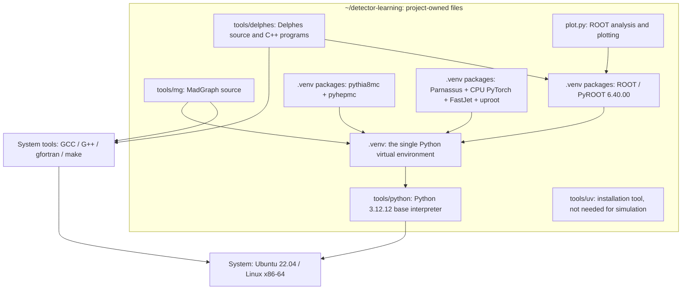

# Dependencies: one system, two independent projects

[简体中文](dependencies.zh-CN.md)

On the prepared machine, `~/smeftsim` and `~/detector-learning` are separate Linux directories. The detector project owns Python 3.12, ROOT, MadGraph and Delphes. At runtime it reads no interpreter, software library or simulation data from the older project. They share Ubuntu, system compilers and the virtual disk hosting Linux.

## 1. The detector project alone

Arrows mean “requires for execution or building”, rather than simulation data flow:



Parnassus writes ROOT-format files through `uproot` and does not itself require PyROOT. ROOT provides the Delphes build libraries and analysis interface here. Installing it in the same environment means you always use the same `python`.

Delphes includes C++ FastJet/Tcl source; Parnassus uses the Python FastJet wheel. They serve separate backends, so there is no need to compile a third FastJet installation.

## 2. Systems, environments and packages

| Layer | Actual location | Role |
|---|---|---|
| Linux system | Ubuntu 22.04 in the prepared WSL distribution `SMEFTsim` | Base libraries, terminal and access to the Linux kernel; the distribution's name does not require the SMEFTsim software |
| System tools | `/usr/bin` and related paths | Git, download tools and compilers, available to both projects |
| Base Python interpreter | `tools/python/cpython-3.12.12-linux-x86_64-gnu` | Project-local Python used by `.venv`; do not delete it after copying only `.venv` |
| Python environment | `.venv` | Isolates third-party Python packages; does not contain system compilers |
| Python packages and prebuilt libraries | `.venv/lib/python3.12/site-packages` | ROOT, Pythia, HepMC, Parnassus, PyTorch and others; see the [lock file](../requirements.lock.txt) |
| Source and compiled programs | `tools/mg`, `tools/delphes` | Python drives MadGraph's generated Fortran; Delphes compiles to C++ programs |
| Installation tool | `tools/uv/bin/uv` | Downloads Python, creates the environment and installs dependencies |
| Graphics compatibility libraries | `.venv/local-libs` | libSM/libICE extracted from Ubuntu packages for this project's ROOT |
| Settings and products | `config`, `work/dy`, `out` | Cards, generated process and simulation outputs; these are data, not environments |

`env.sh` sets these paths for the current terminal; `source .venv/bin/activate` displays the environment in the prompt. MadGraph, Pythia, Parnassus and ROOT all use `python`, without switching between Python 3.10 and 3.12.

Commands use relative paths from the project root. The prepared machine retains `tools/MG5_aMC_v2_9_27`, `work/drell_yan` and `outputs` as compatibility symlinks to `tools/mg`, `work/dy` and `out`. New installations create only the short names. Neither the project root nor `.venv` was moved, so existing interpreter and library absolute paths remain valid.

## 3. Why Python 3.12 can serve the whole project

The pinned Parnassus version requires Python `>=3.12,<3.13`; [ROOT 0.1a12](https://pypi.org/project/ROOT/0.1a12/) provides a matching CPython 3.12 Linux wheel. Extension packages must match the interpreter, so this project installs that wheel separately rather than pointing at Python 3.10's ROOT directory.

The previous Python 3.10 call reused a tested environment; it was not a requirement that this exercise only run on 3.10. MadGraph 2.9.27 has now exported and compiled the SM LO dimuon process and generated 200 events using this project's Python 3.12. Its version and upstream source remain unchanged. Older source may emit `SyntaxWarning: invalid escape sequence` on first use; generation succeeded without editing upstream source to suppress those warnings. Other models, NLO calculations and plugins need their own validation.

Delphes has been rebuilt against this project's ROOT. Both its library search paths and binary RUNPATH point here. Documentation or a Python command change alone would not accomplish that rebuild.

## 4. Boundaries between projects

```text
/home/smeft/
├── smeftsim/           Existing project with its Python 3.10 .venv and tools
└── detector-learning/  Detector project with its Python 3.12 .venv and tools
```

A second Linux system is unnecessary. A new machine can install only Ubuntu and the software listed in [setup.md](setup.md), without installing the older project. On the prepared machine, enter either directory separately. Open a new terminal when switching projects, then activate the corresponding environment.

**The prepared machine's Windows file `projects/smeftsim/vm/SMEFTsim/ext4.vhdx` holds the shared Linux system and both directories above.** Independent software does not make that disk, or the entire Windows `smeftsim` directory, safe to delete. The Windows `projects/detector-learning` folder contains only a README and launcher; documentation and runtime files stay in Linux.

## 5. Validated scope

The independent environment ran MadGraph → Pythia → both detector backends → ROOT plotting, with 200 events at each stage. Within each backend, same-input/same-seed replay gave exactly equal event-by-event muon pT values. Conversion differences for stable-particle four-momenta and production positions were zero. Actual Python package paths, Delphes shared libraries and RUNPATH do not refer to the older project.

[examples/validation.json](../examples/validation.json) records versions and results. These checks used the existing Ubuntu system; the setup guide has not yet been replayed in full on another fresh machine. The physics comparison remains a small-sample interface exercise; see the [handbook](handbook.md).
