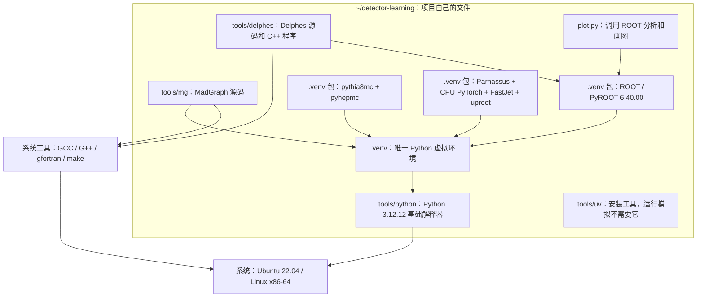

# 依赖关系：一个系统、两个独立项目

[English](dependencies.md)

本机的 `~/smeftsim` 和 `~/detector-learning` 是两个不同的 Linux 目录。新项目有自己的 Python 3.12、ROOT、MadGraph 和 Delphes；运行时不读取旧项目的 Python、软件库或模拟数据。两者只共享 Ubuntu 系统、系统编译器和承载 Linux 的虚拟磁盘。

## 1. 只看新项目

下图的箭头表示“运行或构建需要”，不是模拟数据流：



Parnassus 通过 `uproot` 写 ROOT 格式文件，本身不依赖 PyROOT。ROOT 在这里承担 Delphes 构建和交互分析；把它装进同一环境，是为了让你始终使用同一个 `python`。

Delphes 自带 FastJet/Tcl 的 C++ 源码；Parnassus 使用 Python 的 FastJet wheel。它们分别服务于两个后端，不需要另外编译第三套 FastJet。

## 2. 哪些是系统、环境、软件包

| 层次 | 实际位置 | 作用 |
|---|---|---|
| Linux 系统 | WSL 发行版 `SMEFTsim` 中的 Ubuntu 22.04 | 提供内核接口、基础共享库和终端；名称不意味着必须安装 SMEFTsim 软件 |
| 系统工具 | `/usr/bin` 等 | Git、下载工具和编译器；两个项目都可以使用 |
| Python 基础解释器 | `tools/python/cpython-3.12.12-linux-x86_64-gnu` | `.venv` 所依赖的项目内 Python，不能只复制 `.venv` 后删掉它 |
| Python 环境 | `.venv` | 隔离本项目的第三方 Python 包；不包含系统级编译器 |
| Python 包及其预编译库 | `.venv/lib/python3.12/site-packages` | ROOT、Pythia、HepMC、Parnassus、PyTorch 等；版本见 [锁文件](../requirements.lock.txt) |
| 源码及编译程序 | `tools/mg`、`tools/delphes` | MadGraph 用 Python 驱动生成并编译 Fortran；Delphes 编译为 C++ 程序 |
| 安装工具 | `tools/uv/bin/uv` | 下载 Python、创建环境和安装依赖 |
| 图形兼容库 | `.venv/local-libs` | 从 Ubuntu 包提取的 libSM/libICE；仅供本项目 ROOT 加载 |
| 输入设置与产物 | `config`、`work/dy`、`out` | 卡、生成过程和模拟结果，属于数据而不是环境 |

`env.sh` 为当前终端指向这些位置；`source .venv/bin/activate` 使提示符显示环境。MadGraph、Pythia、Parnassus 和 ROOT 的 Python 操作都用 `python`，不用在 Python 3.10 和 3.12 之间切换。

命令在项目根目录使用相对路径。本机旧名称 `tools/MG5_aMC_v2_9_27`、`work/drell_yan`、`outputs` 仍作为符号链接指向 `tools/mg`、`work/dy`、`out`，让已有配置和结果继续可用；新安装只创建短名称。项目根目录与 `.venv` 没有搬迁，不改变已有解释器和库的绝对路径。

## 3. 为什么可以统一到 Python 3.12

Parnassus 固定版本要求 Python `>=3.12,<3.13`；[ROOT 0.1a12](https://pypi.org/project/ROOT/0.1a12/) 提供对应的 CPython 3.12 Linux wheel。Python 扩展包必须匹配解释器版本，所以这里单独安装该 wheel，不能把旧 Python 3.10 的 ROOT 目录接到新环境中。

之前调用旧项目 Python 3.10 是为了复用已验证的环境，并不说明本练习只能在 3.10 上运行。现在 MadGraph 2.9.27 已使用本项目 Python 3.12 完成 SM LO 双轻子过程的导出、编译和 200 事件生成，因此保留原版本和上游源码。旧源码首次运行可能出现 `SyntaxWarning: invalid escape sequence`；本次生成已成功，不需要为消除这类提示修改源码。其他模型、NLO 或插件需要各自验证。

Delphes 已用本项目 ROOT 重新编译，库搜索路径和二进制 RUNPATH 都指向这里。只改文档或 Python 启动命令不能完成这一步。

## 4. 两个项目的边界

```text
/home/smeft/
├── smeftsim/           原项目，保留自己的 Python 3.10 .venv 与工具
└── detector-learning/  新项目，自己的 Python 3.12 .venv 与工具
```

不需要第二套 Linux 系统。新机器可以只安装 Ubuntu 和本教程列出的软件，完全不安装旧项目；步骤见 [setup.md](setup.zh-CN.md)。当前机器保留原项目，你仍可分别进入两个目录学习。切换项目时打开新的终端，再激活对应环境。

**本机 Windows 的 `projects/smeftsim/vm/SMEFTsim/ext4.vhdx` 是共享 Linux 系统的磁盘，内部包含上面两个目录。** 软件独立不意味着可以删除这个磁盘或整个 Windows `smeftsim` 文件夹。Windows 的 `projects/detector-learning` 只保留 README 和启动入口；文档、环境和运行结果统一位于 Linux。

## 5. 已验证的范围

独立环境完成了 MadGraph → Pythia → 两种探测器 → ROOT 绘图：各阶段 200 事件；同输入、同种子重复运行的 Muon pT 在各自后端逐事件相等。稳定粒子四动量和产生位置转换差异为零。Python 包实际路径、Delphes 的共享库和 RUNPATH 均不引用旧项目。

数值和版本记录见 [examples/validation.json](../examples/validation.json)。这是现有 Ubuntu 系统上的运行验证；安装指南尚未在另一台全新机器完整重放。物理比较仍是小样本接口练习，范围见 [handbook](handbook.zh-CN.md)。
