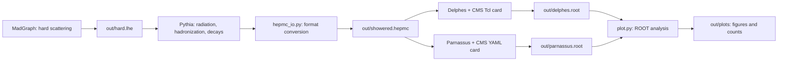

# Pythia → Delphes / Parnassus handbook

[简体中文](handbook.zh-CN.md)

Use 200 SM dimuon events to understand a simulation chain. Read the [README](../README.md) first. The prepared machine is ready; on a new machine, follow [setup.md](setup.md). See [dependencies.md](dependencies.md) for the dependency layers.

The focus is how three packages process events. You call Pythia, run both detector backends and inspect their outputs. The supplied `plot.py` handles plots and count summaries, so you do not need to type a plotting program into the interpreter.

For each **Bash command: enter the whole line → press Enter → wait for the prompt**. Inside Python the prompt is `>>>`: press Enter after each ordinary statement, and an extra blank Enter after a loop. Edit card contents in an editor.

## 1. Follow the files through the chain

The benchmark is $pp\to\mu^+\mu^-$ at a center-of-mass energy of 13 TeV, with a generator-level dilepton mass of 60–120 GeV. MadGraph includes the SM $Z/\gamma^*$ amplitudes and their interference. This exercise introduces neither SMEFT coefficients nor a neural model.



**Delphes and Parnassus are parallel branches.** Both read the same HepMC file. Parnassus does not read Delphes's ROOT file or generate another hard scattering.

| File or object | Contents | Use in the next stage |
|---|---|---|
| `hard.lhe` | Beams, hard-scattering particles, four-momenta, weights and cross-section information | Pythia reads events and continues the simulation |
| `pythia.event` | The current event's beams, radiation, hadrons, decay history and final particles | Inspect in memory or pass to the format-conversion function |
| `showered.hepmc` | Serialized particles, vertices, units and event weights | Each detector backend reads it separately |
| `delphes.root` / `parnassus.root` | Reconstructed objects and their fields for each event | An analysis counts muons, jets, missing transverse momentum and other quantities |
| `plots/counts.json` | Event counts, muon object counts and selected-event counts | Check event preservation and interpret shapes and acceptance |

**LHE particles, stable detector-input particles and reconstructed muons are different levels.** Physics simulation connects them. HepMC conversion itself only exchanges formats.

Here “truth” means stable particles after showering and hadronization. ISR is initial-state radiation; FSR is final-state radiation; MPI means multiple parton interactions within one proton collision. MPI differs from pileup due to additional collisions. This exercise adds no pileup.

## 2. Enter the project and use short paths

On the prepared Windows machine, double-click `enter-linux.cmd`. After the Linux prompt appears, run these commands one at a time:

```bash
cd ~/detector-learning
source env.sh
source .venv/bin/activate
python --version
```

Expect Python 3.12.12. Unless a later step explicitly uses `cd`, execute commands from the project root with relative paths:

| Directory | Role |
|---|---|
| `tools/mg`, `tools/delphes`, `tools/parnassus` | Software sources and compiled programs |
| `config` | Editable settings for this exercise |
| `work/dy` | MadGraph's exported dilepton process; dy means Drell–Yan |
| `out` | LHE, HepMC and detector outputs |
| `out/plots` | Figures, histograms and counts produced by the plotting script |
| `examples` | Small reference results supplied with the tutorial |

The prepared machine uses these short names and retains the old names as symlinks. Results previously generated in `outputs` or `work/drell_yan` remain available; no rerun or copying is required. Use the short names from now on.

MadGraph, Pythia, Parnassus and ROOT use this environment's `python`. Delphes is a C++ program linked to this project's ROOT. `env.sh` affects only the current terminal; open a new terminal when returning to the separate SMEFTsim project.

## 3. MadGraph: prepare the hard-scattering input

This stage reads the process definition and cards, and writes **LHE**. It calculates hard-scattering matrix elements and samples phase space; it does not yet produce a complete hadronic event or detector response.

If you already generated `out/hard.lhe`, continue at section 4. The prepared machine also retains a reference input. To study only the downstream stages there:

```bash
mkdir -p out
cp -n out/reference/hard.lhe out/hard.lhe
grep -c '<event>' out/hard.lhe
```

`cp -n` does not overwrite an existing target. Expect 200 events. This full LHE is not distributed, so new installations must generate it using the following steps.

### 3.1 Export the process

Skip export if `work/dy` already exists. In a new workspace, enter in **Bash**:

```bash
python tools/mg/bin/mg5_aMC
```

At **`MG5_aMC>`**, enter each command separately:

```text
set auto_update 0 --no_save
import model sm
generate p p > mu+ mu-
display processes
output work/dy
quit
```

`generate` identifies and organizes the process amplitudes; `output` exports code for the subsequent calculation. Neither command means events have already been sampled. Do not overwrite an existing process directory.

### 3.2 Configure the run card: lower limits, upper limits and hidden options

**Bash:**

```bash
nano work/dy/Cards/run_card.dat
```

Change existing entries in the editor, preserving the `value = name` format:

| Name | Value for this exercise | Meaning |
|---|---:|---|
| `nevents` | 200 | Requested number of events |
| `iseed` | 12345 | Hard-scattering random seed; check before each new run |
| `ebeam1`, `ebeam2` | 6500 each | Proton beam energies in GeV |
| `ptl` | 10 | Generator-level charged-lepton transverse-momentum lower limit in GeV |
| `ptlmax` | **Keep -1.0** | A negative value disables the transverse-momentum upper limit |
| `etal` | 2.5 | Generator-level upper limit on charged-lepton absolute pseudorapidity |
| `mmll`, `mmllmax` | 60, 120 | Dilepton mass window in GeV |
| `pdlabel`, `lhaid` | Keep `nn23lo1`, `247000` | Built-in PDF; no separate LHAPDF installation |

Thus `ptl=10`, `ptlmax=-1` imposes a 10 GeV lower limit without an artificial upper limit. Do not also set `ptlmax` to 10: the limits would coincide and remove the allowed phase space. Showering and reconstruction change momenta, so generator cuts do not guarantee that every reconstructed muon passes the same cuts.

**There is no card entry literally called matching/merging.** These methods avoid double counting extra hard partons between matrix elements and showers. MadGraph's simplified run card hides MLM/CKKW options by default. In this version the relevant defaults are `ickkw=0` and `xqcut=0`. This exercise generates a single dilepton matrix-element sample, so you do not need to display, add or edit those options. See the [pinned option definitions](https://github.com/mg5amcnlo/mg5amcnlo/blob/eb76cab72b8d44aac7162ac7221ac08a4384a169/madgraph/various/banner.py).

**Leaving matching/merging off does not disable radiation.** Pythia still runs ISR, FSR, MPI and hadronization, and jets can still appear. Here we do not merge matrix-element samples with different hard-jet multiplicities.

This process generates leptons directly. If you later use `p p > z, z > mu+ mu-`, also understand whether `cut_decays` applies cuts to decay products. Leave the SM mass and width parameter card at its defaults for now. In nano, press `Ctrl+O`, Enter to save, then `Ctrl+X`.

### 3.3 Generate and decompress

**Bash:**

```bash
cd work/dy
./bin/generate_events my_200
```

`my_200` is a run name, not the event count; `nevents` in the card determines the count. If that run already exists, choose another short name and use it in the decompression command below.

In the menu, keep shower, detector, analysis and reweight OFF, and enter `done` as requested. In the card-editing menu, enter `0` or `done` as requested. They stay OFF here so you can call Pythia and the detector backends separately and inspect each interface.

After calculation finishes and the Bash prompt returns:

```bash
cd ../..
mkdir -p out
gzip -dc work/dy/Events/my_200/unweighted_events.lhe.gz > out/hard.lhe
grep -c '<event>' out/hard.lhe
```

Expect 200 events. `gzip -dc` sends decompressed contents to standard output, and `>` saves them as the next stage's input. This command overwrites an existing `out/hard.lhe`. Keep the output filename and `>` on the same command line.

Pythia next reads `out/hard.lhe`; it does not automatically search MadGraph's run directories. The cross section and integration uncertainty appear in the banner/`<init>` block in pb. See the [example record](../examples/validation.json) for the local reference value.

## 4. Pythia: turn hard scatterings into complete particle events

- **Input:** `out/hard.lhe` and `config/shower.cmnd`.
- **Processing:** Radiation, underlying event, hadronization and decays, starting from each hard event.
- **Output:** First the in-memory `pythia.event`, then `out/showered.hepmc`.
- **Next reader:** Both Delphes and Parnassus read this HepMC file.

### 4.1 Read the settings and distinguish configuration from execution

In Bash, open `nano config/shower.cmnd`:

| Setting | Effect in this run |
|---|---|
| `Beams:frameType = 4` | Read external LHE hard events |
| `Beams:LHEF = out/hard.lhe` | Set the actual input path, relative to the project root |
| `Random:setSeed = on`, `Random:seed = 24680` | Fix Pythia's own random sampling |
| `ParticleDecays:limitTau0 = on`, `tau0Max = 10` | Leave particles with proper decay length $c\tau>10$ mm stable |
| `Next:numberShow... = 0` | Reduce automatic printing without changing the physics |
| `Main:numberOfEvents = 200` | A setting a driver can read; the Python library does not start looping automatically |

The first two settings connect Pythia to MadGraph instead of asking it to choose a different hard process. Pythia's seed 24680 and MadGraph's 12345 belong to separate simulation stages.

Keep the defaults for ISR, FSR, MPI and hadronization. A card is a collection of settings; **reading it generates no events**. In Python-library mode, your number of `next()` calls determines how many events are attempted.

### 4.2 Process one event yourself

**Bash:**

```bash
python
```

At **`>>>`**, enter each statement separately:

```python
import pythia8mc
pythia = pythia8mc.Pythia()
assert pythia.readFile("config/shower.cmnd")
assert pythia.init()
assert pythia.next()
pythia.event.list()
print(pythia.event.size())
print(sum(p.isFinal() for p in pythia.event))
```

| Call | What happens now | Writes a file? |
|---|---|---|
| `Pythia()` | Create the generator with settings and event objects | No |
| `readFile(...)` | Load card settings into the object | No |
| `init()` | Initialize beams, read the LHE header and prepare simulation | No |
| `next()` | Attempt the next hard event and update the current `event` | No |
| `event.list()` | Print the current event to inspect particles and history | No |
| `isFinal()` | Test whether a particle is currently final in Pythia's record | No |

`assert` stops if a call returns False, preventing further execution after failed initialization. One `next()` processes one event. The following call replaces the in-memory record; previous events are not automatically retained.

The printed record usually contains far more than two muons because beams, radiation, hadrons and decay history are included. The final-particle count is smaller than the full record. Pythia's native status codes are not the same numbering system as HepMC statuses.

### 4.3 Save 200 events for the detector backends

The preceding step consumed one event. Create and initialize a new generator to restart from the beginning of the LHE. Stay at `>>>`.

The following uses `"w"`, overwriting an existing HepMC file with that name. If your baseline is complete, you can read this section without rerunning it. To preserve the baseline while trying new settings, choose a new output name and make both detector backends read it.

```python
import pyhepmc
from hepmc_io import to_hepmc
pythia = pythia8mc.Pythia()
assert pythia.readFile("config/shower.cmnd")
assert pythia.init()
writer = pyhepmc.open("out/showered.hepmc", "w")
```

Enter the loop with four spaces before each body line. Finish with one blank Enter:

```python
for number in range(200):
    assert pythia.next(), f"Event {number} failed; stop and inspect"
    writer.write(to_hepmc(pythia, number))
```

The body performs separate tasks: `next()` runs physics simulation; `to_hepmc(...)` converts the current record; `writer.write(...)` saves it. Each iteration generates before writing, so it does not write the same event 200 times.

When `>>>` returns, enter these statements separately:

```python
writer.close()
print(pythia.infoPython().nAccepted())
pythia.stat()
exit()
```

`close()` finishes writing; `nAccepted()` returns the successfully processed count; `stat()` prints statistics without generating another event. Expect 200 accepted events. If a `next()` fails, stop and inspect it here rather than retrying forever after EOF.

The supplied `hepmc_io.py` adapter uses `GenEvent.from_hepevt`, sets GeV/mm units, and transfers stable particles, four-momenta, production positions and the SM weight. It checks stable-particle counts and four-momenta before and after conversion. It does not run another shower or detector response.

The adapter makes vertex encoding explicit for the Delphes 3.5.1 reader. `vertex.status=1` is a vertex-encoding marker, not a particle cut. Complete multigeneration histories and SMEFT multiweight propagation are outside the validated scope. See [SOURCES.md](SOURCES.md) for the APIs.

### 4.4 Check the handover file

Back in **Bash**:

```bash
head -n 5 out/showered.hepmc
grep -c '^E ' out/showered.hepmc
sha256sum out/showered.hepmc
```

Expect the HepMC3 header, `U GEV MM`, and 200 event headers. SHA256 fingerprints this input. Both detector backends must read the same path to compare their response to the same events.

You should now distinguish loading settings, initializing, generating one event and saving one event. To change ISR later, call `pythia.readString("PartonLevel:ISR = off")` after `readFile` and before `init`, and use a new output name. FSR, MPI and hadronization still run; do not interpret that change as a detector effect.

## 5. Delphes: reconstruct objects from the particle record

- **Input:** The same `out/showered.hepmc` and a CMS Tcl card.
- **Processing:** Efficiencies, resolutions, calorimetry and reconstruction, following the card's module order.
- **Output:** `out/delphes.root`, with a tree named `Delphes`.
- **Next reader:** `plot.py` reads branches including `Muon` and `Particle`.

### 5.1 The Tcl card is a module execution graph

The prepared machine already has `config/delphes_CMS.tcl`; read it directly. In a new workspace, prepare it once:

```bash
cp tools/delphes/cards/delphes_card_CMS.tcl config/delphes_CMS.tcl
nano config/delphes_CMS.tcl
```

Add `set RandomSeed 31415` as the first line and save. Leave the other modules at their upstream settings. Do not repeatedly copy over a card you have edited.

Read `ExecutionPath` near the top: Delphes runs modules in that order. Each module's `InputArray` reads objects from an earlier module; `OutputArray` supplies a collection to later ones. Finally, `TreeWriter` chooses which collections are written to ROOT. Not all intermediate collections are saved.

Follow a few muon-related entries:

| Module or setting | What it does | What to notice |
|---|---|---|
| `ParticlePropagator` | Propagate particles and organize subsequent inputs according to field and geometry | Stable particles enter the detector model |
| Tracking efficiency and momentum smearing | Randomly decide whether objects are reconstructed and change measured momenta | The reconstructed collection may be smaller than truth, with different momenta |
| `MuonEfficiency` | Retain muon candidates according to the efficiency formula | Not every stable muon survives |
| `MuonIsolation` | Reject objects with too much nearby activity | The final `Muon` collection is already isolated |
| `TreeWriter` | Write selected collections as branches | `Particle` contains truth records; `Muon` contains reconstructed objects |

`Jet` comes from clustering; `MissingET` is reconstructed missing transverse momentum. They are not columns copied directly from the LHE. Start with muons rather than trying to understand every module in the CMS card at once.

### 5.2 Run it and understand the three positional arguments

**Bash, from the project root:**

```bash
tools/delphes/DelphesHepMC3 config/delphes_CMS.tcl out/delphes.root out/showered.hepmc
```

| Command component | Role |
|---|---|
| `DelphesHepMC3` | Compiled HepMC3 reader and detector simulation |
| First argument, `config/delphes_CMS.tcl` | **Read settings** and the module graph |
| Second argument, `out/delphes.root` | **Write output** |
| Third argument, `out/showered.hepmc` | **Read input** |

The program reads each event, runs the module graph and writes the tree. It calls neither MadGraph nor Pythia. The order “card, output, input” follows the [Delphes interface](https://delphes.github.io/workbook/quick-tour/).

Delphes refuses to overwrite an existing ROOT file. If you completed the earlier handbook, skip rerunning this baseline. For a new setting, choose a name such as `out/delphes2.root`. Section 7 checks the tree's event count; normal termination alone does not prove that no events were lost.

## 6. Parnassus: a different response to the same input

- **Input:** The same `out/showered.hepmc` and a YAML card.
- **Processing:** Parametric CMS response, followed by the YAML clustering and isolation calculations.
- **Output:** `out/parnassus.root`, with a tree named `Parnassus`.
- **Next reader:** `plot.py` reads branches including `Muons.*` for comparison with Delphes.

### 6.1 Distinguish the response model from postprocessing pipelines

Read `config/parnassus.yaml`. A run has three parts:

1. `generator.type: parametric` and `name: cms` select a PyTorch implementation of a parametric CMS response, turning input particles into simulated reconstructed objects. This mode needs no neural generator, GPU or training.
2. `pipelines` calculate further quantities from those objects: `PFlowJetsAntiKt05` clusters simulated particle-flow objects; `MuonIsolation` calculates nearby activity for muons.
3. `output.format: default` writes results into a ROOT tree.

| YAML section | Meaning in this card |
|---|---|
| `dataset.num_events: 200` | Upper limit on the total processed event count |
| `dataset.entry_start: 0` | Start with the first input event |
| `generator.seed: 31415` | Random seed for the parametric response |
| `PFlowJetsAntiKt05` | This key also determines the collection's name in ROOT |
| `algorithm: antikt`, `dr: 0.5` | Anti-$k_T$ clustering with $R=0.5$ |
| `pt_min: 10`, `nconst_min: 2` | Jets must pass pT and constituent-count requirements |
| `MuonIsolation.dr: 0.5` | Calculate nearby activity in a cone of $R=0.5$ |

**Here MuonIsolation adds a variable; it does not automatically remove nonisolated muons.** The analysis therefore applies `Muons.IsolationVar<0.25`. Delphes's final muon collection is already isolated. The two outputs cannot be read using identical branch names or selection expressions.

Isolation measures surrounding activity relative to the muon's transverse momentum. This pinned version sums pT from charged hadrons, neutral hadrons and photons in the cone and divides by the muon's pT. Smaller values mean greater isolation. The muon itself is excluded from the numerator; `IsolationVar<0.25` requires this nearby activity to be below 25% of its pT. Reducing the cone radius reduces the summation region, which section 8 explores.

The two “CMS” labels do not imply identical implementations. For example, the upstream Delphes card sets a 20 GeV minimum jet pT, while this Parnassus card uses 10 GeV and a constituent-count cut. Do not attribute differing jet counts directly to simulation accuracy. The current plots focus on muons. See [SOURCES.md](SOURCES.md) for the pinned implementation.

### 6.2 Run it and understand each argument

**Bash; enter the entire line before pressing Enter:**

```bash
OMP_NUM_THREADS=4 MKL_NUM_THREADS=4 parnassus run -c config/parnassus.yaml -i out/showered.hepmc -ne 200 -bs 10 -o out/parnassus.root --random_seed 31415
```

| Argument | Role |
|---|---|
| The two leading thread settings | Limit CPU threads for this process only |
| `run` | Run simulation and write output |
| `-c` | Read the YAML card |
| `-i` | Set the HepMC input, overriding its YAML path |
| `-ne 200` | Process at most 200 input events in total |
| `-bs 10` | Process response calculations in batches of 10; this is not the total count |
| `-o` | Set the ROOT output, overriding its YAML path |
| `--random_seed 31415` | Override the YAML parametric seed; deliberately the same value here |

Keep batch size fixed for same-seed replay, since different batching may change random-number consumption. Neural-mode ODE steps are a different option and are not used here.

The log should report 200 processed events. Each tree entry represents an event. `Muons.PT` is a list of muons in that event, whereas `Event.PFlowMET` is one number per event. **200 entries do not imply 200 muons.**

## 7. Plot with one command and interpret the results

After running both detector backends, enter in **Bash**:

```bash
python plot.py
```

The script reads `out/delphes.root` and `out/parnassus.root`, checks trees, branches and 200 events in each, then plots with ROOT. It does not rerun simulations or modify either input. Rerunning replaces analysis products with the same names in `out/plots`.

| File in `out/plots` | What to inspect |
|---|---|
| `muon_pt.png`, `muon_pt.pdf` | Muon transverse-momentum shapes for stable truth, Delphes and Parnassus |
| `dimuon_mass.png`, `dimuon_mass.pdf` | Mass of the two selected muons with the highest pT |
| `counts.json` | Input paths, event counts, muon object counts, dimuon event counts and selection fractions |
| `comparison_histograms.root` | The five histograms for later inspection |

The muon analysis selection is $p_T>10$ GeV and $|\eta|<2.4$, with `IsolationVar<0.25` also required for Parnassus. The dimuon mass uses the two highest-pT selected objects, without an additional charge-pairing requirement in this exercise.

Plots are normalized to 1 within the plotted range and compare shapes. The vertical axis is neither pb nor divided by bin width. Read acceptance from the raw counts in `counts.json`; distinguish object counts from event counts. With 200 events you cannot validate detailed detector performance, and the two responses need not coincide.

First run `cat out/plots/counts.json`, then open the images. In WSL, `explorer.exe out/plots` opens that directory. See [examples](../examples/README.md) for local reference plots and counts; different runs need not match every value.

For different output names, tell the script explicitly:

```bash
python plot.py --delphes out/delphes2.root --parnassus out/parnassus.root --out out/plots2
```

If the event count changes, add `--expect` followed by the new count. Run `python plot.py --help` for arguments. The ROOT statements are collected in one source file; you do not need to type them into the terminal.

## 8. Understand a pipeline through one small change

After completing the baseline, change only **Parnassus's muon isolation cone**. Follow that setting through simulation output into analysis, retaining existing results.

**Bash:**

```bash
cp config/parnassus.yaml config/iso.yaml
nano config/iso.yaml
```

Under `MuonIsolation` only, change `dr: 0.5` to `dr: 0.3`. Do not change the jet pipeline's `dr`, the seed or any other setting. Save and run:

```bash
OMP_NUM_THREADS=4 MKL_NUM_THREADS=4 parnassus run -c config/iso.yaml -i out/showered.hepmc -ne 200 -bs 10 -o out/iso.root --random_seed 31415
python plot.py --parnassus out/iso.root --out out/iso
```

This `parnassus run` command still reruns the full response and postprocessing from HepMC. Keeping input, model, seed, batch size and version fixed reproduces the original muon momenta; the new change comes from the isolation postprocessing cone. Compare `out/plots/counts.json` and `out/iso/counts.json`. The muons passing isolation may change, although a small sample need not show a count change. The isolation variable and selection together determine the collection used in the plots.

This connects “edit a setting → write new ROOT → analyze new branches → compare counts and plots”. Later, try Delphes efficiencies/resolutions or Pythia ISR one setting at a time, so you can interpret the cause of each change.

### Optional: same-seed replay

Run both backends again on the same HepMC, keeping cards, seeds and batch size unchanged. If the following targets already exist, choose new names and adjust the reading code too.

**Bash:**

```bash
tools/delphes/DelphesHepMC3 config/delphes_CMS.tcl out/delphes2.root out/showered.hepmc
OMP_NUM_THREADS=4 MKL_NUM_THREADS=4 parnassus run -c config/parnassus.yaml -i out/showered.hepmc -ne 200 -bs 10 -o out/parnassus2.root --random_seed 31415
```

Read values in Python with the already installed uproot/awkward:

```bash
python
```

```python
import uproot
import awkward as ak
```

Enter the loop, then press one blank Enter:

```python
for name, tree, branch in [("delphes", "Delphes", "Muon.PT"), ("parnassus", "Parnassus", "Muons.PT")]:
    a = uproot.open(f"out/{name}.root")[tree][branch].array()
    b = uproot.open(f"out/{name}2.root")[tree][branch].array()
    assert len(a) == len(b) == 200
    assert ak.almost_equal(a, b, rtol=0, atol=0)
    print(name, "same")
```

Enter `exit()` to return to Bash. This only reads files and checks values; it adds no simulation stage. It tests each backend's repeatability under identical conditions, rather than equality between different backends. It does not compare ROOT file bytes, which can include time-dependent metadata.

You have completed this exercise when you can follow the files to explain each package's inputs, physics processing and outputs; change one setting and explain which stage it affects; and check event counts, object counts and plots. Full CMS performance validation, neural models, SMEFT weight propagation and cluster execution are later tasks.
