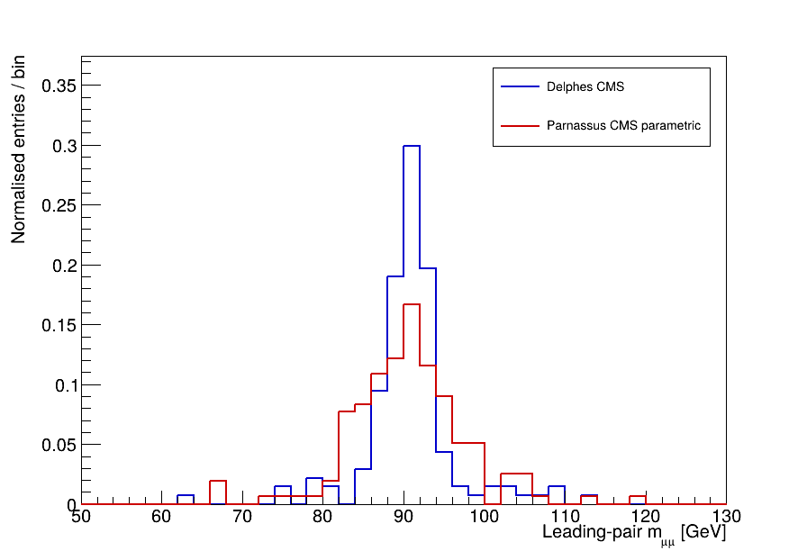

# 本机验证示例

[English](README.md)

这些结果来自 2026-10-14 的本地 200 事件 SM Drell–Yan 练习。整条链已使用独立 Python 3.12 环境重新验证：硬事件内容和 HepMC 输入校验值与原基线一致，选择计数和直方图也保持一致。完整设置、事件数和环境版本在 [validation.json](validation.json)，版本与来源在 [SOURCES](../docs/SOURCES.zh-CN.md)。

| 文件 | 内容 |
|---|---|
| `muon_pt.png`, `muon_pt.pdf` | 稳定 truth、Delphes、Parnassus 的 Muon pT 形状比较 |
| `dimuon_mass.png`, `dimuon_mass.pdf` | 两种重建响应的领先双 Muon 质量 |
| `comparison_histograms.root` | 上述五条已归一化直方图，供 ROOT 检查 |
| `validation.json` | 输入、种子、切选、截面、计数和重复性检查 |

图在指定绘图区间内归一化。曲线面积不保留接受率；接受率必须用原始计数计算。图显示中央值，200 事件不足以验证精细探测器性能。两种程序的粒子流、效率及隔离细节不同，不要求曲线完全重合。

在 Linux 项目根目录运行 `python plot.py` 可分析自己的 `out/delphes.root` 和 `out/parnassus.root`，结果写入 `out/plots`；其中 `counts.json` 保存未归一化计数。只重画本机参考结果时运行：

```bash
source env.sh
source .venv/bin/activate
python plot.py --delphes out/reference/delphes.root --parnassus out/reference/parnassus.root --out out/refplots
```

仓库不分发这两份原始探测器文件。脚本与下面五条参考直方图逐 bin 核对过内容、误差和 entries；选择及归一化定义保持一致。




如果只想检查现有直方图，从 Linux 项目根目录进入 ROOT 的 Python：

```bash
source env.sh
source .venv/bin/activate
python
```

在 `>>>` 中逐行回车：

```python
import ROOT
ROOT.gROOT.SetBatch(True)
f = ROOT.TFile.Open("examples/comparison_histograms.root")
f.ls()
h = f.Get("htruth")
print(h.Integral())
f.Close()
exit()
```

`htruth`、`hdelphes`、`hparna` 是 pT 图；`dimuon_delphes`、`dimuon_parna` 是质量图。积分应约为 1。本例不附完整 LHE/HepMC 或探测器树，因为它们可在 Linux 按手册生成。
