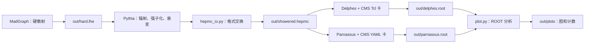

# Pythia → Delphes / Parnassus 学习手册

[English](handbook.md)

本教程用 200 个 SM 双 Muon 事件认识模拟链。先看 [README](README.zh-CN.md)；本机环境已配置，新机器按 [setup](setup.zh-CN.md) 安装。依赖层次见 [dependencies](dependencies.zh-CN.md)。

学习重点是三个包怎样处理事件。你亲手调用 Pythia、运行两个探测器并查看输出；已有的 `plot.py` 负责画图和汇总计数，不再要求手打画图程序。

每条 **Bash 命令整行输入 → 回车 → 等提示符回来**。进入 Python 后提示符是 `>>>`；普通语句逐行回车，循环末尾另按一次空白回车。卡文件的内容在编辑器里修改。

## 1. 先沿着文件认识这条链

基准过程是 $pp\to\mu^+\mu^-$，质心能量 13 TeV，生成层双轻子质量为 60–120 GeV。MadGraph 使用 SM 的 $Z/\gamma^*$ 振幅及干涉；本轮不引入 SMEFT 系数或神经模型。



**Delphes 和 Parnassus 是两条平行分支。** 两者读取同一份 HepMC；Parnassus 不读取 Delphes 的 ROOT 文件，也不再生成一次硬散射。

| 文件或对象 | 里面有什么 | 下一步怎样使用 |
|---|---|---|
| `hard.lhe` | 束流、硬散射粒子、四动量、权重与截面信息 | Pythia 逐事件读取，继续模拟 |
| `pythia.event` | 当前一个事件的束流、辐射、强子、衰变历史及最终粒子 | 在内存中查看，或交给格式交换函数 |
| `showered.hepmc` | 序列化后的粒子、顶点、单位和事件权重 | 两种探测器分别读取 |
| `delphes.root` / `parnassus.root` | 每个事件的重建对象及其字段 | 分析程序统计 Muon、jet、缺失横动量等 |
| `plots/counts.json` | 事件数、Muon 对象数、通过选择的事件数 | 判断是否丢事件，解释图和接受率 |

**LHE 粒子不等于探测器输入的稳定粒子，也不等于重建 Muon。** 这三个层次之间发生了物理模拟；HepMC 转换本身只做格式交换。

本教程把 shower/强子化后的稳定粒子称为 truth。ISR 是初态辐射，FSR 是末态辐射，MPI 是同一次质子碰撞中的多重部分子相互作用。MPI 不等于其他碰撞叠加形成的 pileup；本练习不加 pileup。

## 2. 进入项目，只输入一次长路径

Windows 中双击 `enter-linux.cmd`。看到 Linux 提示符后逐条执行：

```bash
cd ~/detector-learning
source env.sh
source .venv/bin/activate
python --version
```

应为 Python 3.12.12。下面除明确写出 `cd` 外，命令都在项目根目录执行，使用相对路径：

| 目录 | 用途 |
|---|---|
| `tools/mg`、`tools/delphes`、`tools/parnassus` | 软件源码及编译程序 |
| `config` | 本练习可编辑的设置 |
| `work/dy` | MadGraph 导出的双轻子过程；dy 指 Drell–Yan |
| `out` | LHE、HepMC、探测器输出 |
| `out/plots` | 画图脚本生成的图、直方图和计数 |
| `examples` | 随教程提供的小型参考结果 |

当前机器已将旧长目录换为这些短名称，并保留旧名称的符号链接。你之前用 `outputs`、`work/drell_yan` 生成的结果仍然保留，不需要重跑或复制；后续统一用短名称。

MadGraph、Pythia、Parnassus、ROOT 都使用这个环境的 `python`。Delphes 是链接本项目 ROOT 的 C++ 程序。`env.sh` 只影响当前终端；切回原 SMEFTsim 项目时打开新终端。

## 3. MadGraph：准备硬散射输入

这一节读取过程定义和卡，输出 **LHE**。它完成硬散射矩阵元及相空间抽样，还没有生成完整强子事件或探测器响应。

你已经生成过 `out/hard.lhe` 时可直接进入第 4 节。本机还保留一份参考输入，若只学习下游，可执行：

```bash
mkdir -p out
cp -n out/reference/hard.lhe out/hard.lhe
grep -c '<event>' out/hard.lhe
```

`cp -n` 在目标已存在时不覆盖；计数应为 200。新机器不附这份完整 LHE，需要按下面步骤生成。

### 3.1 导出过程

`work/dy` 已存在时跳过导出。新工作区在 **Bash** 输入：

```bash
python tools/mg/bin/mg5_aMC
```

在 **`MG5_aMC>`** 中逐条输入：

```text
set auto_update 0 --no_save
import model sm
generate p p > mu+ mu-
display processes
output work/dy
quit
```

`generate` 列出并组织这个过程的振幅；`output` 导出后续计算所需代码。它们不等于已经抽样得到事件。过程目录已存在时不要覆盖。

### 3.2 配置 run 卡：下限、上限和隐藏选项

**Bash：**

```bash
nano work/dy/Cards/run_card.dat
```

在编辑器中修改已有条目，保留 `value = name` 的格式：

| 名称 | 本练习值 | 含义 |
|---|---:|---|
| `nevents` | 200 | 请求事件数 |
| `iseed` | 12345 | 硬散射随机种子；每次新 run 前重新检查 |
| `ebeam1`、`ebeam2` | 各 6500 | 两束质子的能量，GeV |
| `ptl` | 10 | 生成层带电轻子横动量下限，GeV |
| `ptlmax` | **保留 -1.0** | 负值表示不施加横动量上限 |
| `etal` | 2.5 | 生成层带电轻子绝对赝快度上限 |
| `mmll`、`mmllmax` | 60、120 | 双轻子质量窗口，GeV |
| `pdlabel`、`lhaid` | 保留 `nn23lo1`、`247000` | 使用内置 PDF，不另装 LHAPDF |

所以 `ptl=10`、`ptlmax=-1` 表示设置 10 GeV 的下限，没有人为设置上限。不要把 `ptlmax` 也改成 10，否则上下限重合，会把相空间切掉。后续 shower 和重建会改变动量，因此生成层切选并不保证重建后的每条 Muon 都满足它。

**卡里没有名为 matching/merging 的条目。** 它们是避免额外硬 parton 在矩阵元与 shower 中重复计数的方法。MadGraph 的简版 run 卡默认隐藏 MLM/CKKW 选项；本版本相关默认值为 `ickkw=0`、`xqcut=0`。本练习只生成一个双轻子矩阵元样本，不需要显示、添加或修改这些选项。[固定版本的选项定义](https://github.com/mg5amcnlo/mg5amcnlo/blob/eb76cab72b8d44aac7162ac7221ac08a4384a169/madgraph/various/banner.py)

**不做 matching/merging 不等于关闭辐射。** Pythia 后面仍运行 ISR、FSR、MPI 和强子化，也仍可能产生 jet；这里没有合并不同硬 jet 数目的矩阵元样本。

本过程直接生成轻子。若以后改为 `p p > z, z > mu+ mu-`，还需要理解对衰变产物是否应用切选的 `cut_decays`。SM 参数卡本次保留默认质量和宽度。在 nano 中按 `Ctrl+O`、Enter 保存，再按 `Ctrl+X`。

### 3.3 生成与解压

**Bash：**

```bash
cd work/dy
./bin/generate_events my_200
```

`my_200` 是 run 名，不是事件数；事件数由卡中的 `nevents` 决定。该 run 已存在时换一个短名称，并在后面的解压命令中使用同名。

菜单中让 shower、detector、analysis、reweight 保持 OFF，按菜单要求输入 `done`；卡编辑菜单按要求输入 `0` 或 `done`。这里保持 OFF，是为了后面分别调用 Pythia 和探测器，观察每个接口。

计算完成、Bash 提示符回来后执行：

```bash
cd ../..
mkdir -p out
gzip -dc work/dy/Events/my_200/unweighted_events.lhe.gz > out/hard.lhe
grep -c '<event>' out/hard.lhe
```

应有 200 个事件。`gzip -dc` 将解压内容写到标准输出，`>` 将它保存为下一步要读的文件；这条命令会覆盖已有的 `out/hard.lhe`。必须把输出文件名和 `>` 放在同一行。

下一步 Pythia 读取 `out/hard.lhe`，不会自动寻找 MadGraph 的 run 目录。截面和积分误差在 banner/`<init>` 中，单位为 pb；本机参考值见 [示例记录](examples/validation.json)。

## 4. Pythia：把硬散射变成完整粒子事件

- **输入：** `out/hard.lhe` 和 `config/shower.cmnd`。
- **处理：** 从硬事件出发，模拟辐射、底事件、强子化及衰变。
- **输出：** 先是内存中的 `pythia.event`，再保存为 `out/showered.hepmc`。
- **下一步：** Delphes 和 Parnassus 都读取这个 HepMC 文件。

### 4.1 先读设置，分清“设置”与“执行”

在 Bash 输入 `nano config/shower.cmnd` 阅读：

| 设置 | 对本次运行的作用 |
|---|---|
| `Beams:frameType = 4` | 使用外部 LHE 硬事件 |
| `Beams:LHEF = out/hard.lhe` | 指定实际输入；相对项目根目录解释 |
| `Random:setSeed = on`、`Random:seed = 24680` | 固定 Pythia 自己的随机抽样 |
| `ParticleDecays:limitTau0 = on`、`tau0Max = 10` | 固有寿命对应的 $c\tau>10$ mm 的粒子留作稳定粒子 |
| `Next:numberShow... = 0` | 减少自动打印；不改变物理 |
| `Main:numberOfEvents = 200` | 供驱动程序读取的设置；Python 库不会据此自动开始循环 |

前面两条使 Pythia 接在 MadGraph 后面，而非让它自己选择另一种硬过程。种子 24680 与 MadGraph 的 12345 分属不同模拟阶段。

默认保留 ISR、FSR、MPI 和强子化。卡文件只是设置集合；**读卡不会生成事件**。Python 模式实际处理多少事件，由你下面调用多少次 `next()` 决定。

### 4.2 亲手处理一个事件

**Bash：**

```bash
python
```

在 **`>>>`** 逐条输入：

```python
import pythia8mc
pythia = pythia8mc.Pythia()
assert pythia.readFile("config/shower.cmnd")
assert pythia.init()
assert pythia.next()
pythia.event.list()
print(pythia.event.size())
print(sum(p.isFinal() for p in pythia.event))
```

| 调用 | 此刻发生什么 | 是否写文件 |
|---|---|---|
| `Pythia()` | 创建生成器及其设置、事件对象 | 否 |
| `readFile(...)` | 把卡中的设置读入对象 | 否 |
| `init()` | 初始化束流、读 LHE 头部并准备模拟 | 否 |
| `next()` | 尝试处理下一个硬事件，更新当前 `event` | 否 |
| `event.list()` | 打印当前事件，便于查看粒子和历史 | 否 |
| `isFinal()` | 判断某条粒子是否是 Pythia 当前最终粒子 | 否 |

`assert` 遇到返回 False 时停止，避免初始化失败后继续执行。这里的一次 `next()` 只处理一个事件；下一次调用会替换内存中的当前记录，不会自动保留上一条。

打印表格里的记录数通常远多于两条 Muon，因为还包含束流、辐射、强子和衰变历史。最终粒子数又小于完整记录数。Pythia 原始状态码与 HepMC 状态码不是同一套编号。

### 4.3 把 200 个事件保存给探测器

上一步已经消耗一个事件。新建生成器并重新初始化，从 LHE 开头开始；仍在 `>>>` 中：

下面用 `"w"` 写文件，会覆盖已有同名 HepMC。已经完成基线时可只阅读这一段；要保留旧文件并尝试新设置，就改用新输出名，并让后面两个探测器一起读取它。

```python
import pyhepmc
from hepmc_io import to_hepmc
pythia = pythia8mc.Pythia()
assert pythia.readFile("config/shower.cmnd")
assert pythia.init()
writer = pyhepmc.open("out/showered.hepmc", "w")
```

然后输入循环，循环体四个空格缩进；最后空白回车一次：

```python
for number in range(200):
    assert pythia.next(), f"Event {number} failed; stop and inspect"
    writer.write(to_hepmc(pythia, number))
```

这两行分别做两件不同的事：`next()` 做物理模拟；`to_hepmc(...)` 整理当前事件格式，`writer.write(...)` 把它写进文件。每次循环都先生成，再保存，因而不会把同一个事件重复写 200 次。

等 `>>>` 回来后逐条输入：

```python
writer.close()
print(pythia.infoPython().nAccepted())
pythia.stat()
exit()
```

`close()` 完成文件写入；`nAccepted()` 返回成功处理数；`stat()` 打印统计，不再生成新事件。应看到 200 个 accepted events。如果某次 `next()` 失败，本练习先停下检查，不使用遇到 EOF 后无限重试的循环。

`hepmc_io.py` 是现有的格式适配模块：使用 `GenEvent.from_hepevt`，设置 GeV/mm 单位、稳定粒子、四动量、产生位置及 SM 权重，并核对转换前后的稳定粒子数和四动量。它没有增加一次 shower 或探测器响应。

模块整理显式顶点编码，是为了兼容 Delphes 3.5.1 的读取器；`vertex.status=1` 是顶点编码标记，不是粒子切选。完整多代历史及 SMEFT 多权重传播超出本次验证范围。接口依据见 [来源](SOURCES.zh-CN.md)。

### 4.4 检查交接文件，再继续

回到 **Bash**：

```bash
head -n 5 out/showered.hepmc
grep -c '^E ' out/showered.hepmc
sha256sum out/showered.hepmc
```

应看到 HepMC3 头部、`U GEV MM` 和 200 个事件头。SHA256 是这份输入的指纹；后面两种探测器必须读同一个路径，才是在比较它们对相同输入的响应。

至此你应能区分：读卡、初始化、生成一个事件、保存一个事件。以后改变 ISR 时，在 `readFile` 后、`init` 前调用 `pythia.readString("PartonLevel:ISR = off")`，并使用新的输出名。FSR、MPI 和强子化仍会运行，不能把变化解释成探测器效应。

## 5. Delphes：由粒子记录得到重建对象

- **输入：** 同一份 `out/showered.hepmc` 和 CMS Tcl 卡。
- **处理：** 依照卡中的模块顺序，模拟效率、分辨率、量能器及重建。
- **输出：** `out/delphes.root`，其中树名是 `Delphes`。
- **下一步：** `plot.py` 读取 `Muon`、`Particle` 等分支。

### 5.1 Tcl 卡是一张模块执行图

本机已有 `config/delphes_CMS.tcl`，直接阅读。新工作区只准备一次：

```bash
cp tools/delphes/cards/delphes_card_CMS.tcl config/delphes_CMS.tcl
nano config/delphes_CMS.tcl
```

在第一行加入 `set RandomSeed 31415`，保存；其他模块保留上游设置。不要反复复制覆盖自己改好的卡。

阅读卡顶端 `ExecutionPath`：Delphes 按这里的顺序运行模块。模块中的 `InputArray` 从前一模块取对象，`OutputArray` 为后续模块提供集合；`TreeWriter` 最后决定哪些集合写入 ROOT。不是每个中间集合都会存盘。

沿着 Muon 找几个位置即可：

| 模块或设置 | 对事件做什么 | 你应注意的结果 |
|---|---|---|
| `ParticlePropagator` | 传播粒子，按磁场和几何组织后续输入 | 稳定粒子开始进入探测器模型 |
| 跟踪效率、动量 smearing | 随机决定是否重建并改变测量动量 | 重建集合可能少于 truth，动量也可能不同 |
| `MuonEfficiency` | 按卡中的效率公式保留候选 Muon | 不是每条稳定 Muon 都会留下 |
| `MuonIsolation` | 根据 Muon 周围活动筛掉不够孤立的对象 | 最终 `Muon` 已经过隔离筛选 |
| `TreeWriter` | 将指定集合写成分支 | 树中 `Particle` 是 truth 记录，`Muon` 是重建对象 |

`Jet` 来自聚类，`MissingET` 是重建层缺失横动量。它们不是从 LHE 直接复制的列。当前主要比较 Muon；不需要一开始就理解整张 CMS 卡的每个模块。

### 5.2 运行：三个位置参数分别是什么

**Bash，项目根目录：**

```bash
tools/delphes/DelphesHepMC3 config/delphes_CMS.tcl out/delphes.root out/showered.hepmc
```

| 命令部分 | 作用 |
|---|---|
| `DelphesHepMC3` | 已编译的 HepMC3 读取和模拟程序 |
| 第一个参数 `config/delphes_CMS.tcl` | 读设置和模块图 |
| 第二个参数 `out/delphes.root` | **写输出** |
| 第三个参数 `out/showered.hepmc` | **读输入** |

程序按事件读取输入、运行整张模块图并写树；不会调用 MadGraph 或 Pythia。这个“卡、输出、输入”的顺序来自 [Delphes 接口](https://delphes.github.io/workbook/quick-tour/)。

Delphes 拒绝覆盖已有 ROOT 文件。你已经跑完旧手册时跳过这次基线运行；尝试新设置时换名，例如 `out/delphes2.root`。第 7 节会核对树中的事件数，不能只凭“正常退出”判断没有丢事件。

## 6. Parnassus：从同一输入走另一种响应

- **输入：** 同一份 `out/showered.hepmc` 和 YAML 卡。
- **处理：** 参数化 CMS 响应，再执行 YAML 中的聚类和隔离计算。
- **输出：** `out/parnassus.root`，其中树名是 `Parnassus`。
- **下一步：** `plot.py` 读取 `Muons.*` 等分支，与 Delphes 比较。

### 6.1 区分响应模型与后处理 pipeline

阅读 `config/parnassus.yaml`。一次运行分为三步：

1. `generator.type: parametric`、`name: cms` 选择用 PyTorch 实现的参数化 CMS 响应，从输入粒子得到模拟后的重建对象。本模式不用神经生成器、GPU 或模型训练。
2. `pipelines` 对这些对象继续计算：`PFlowJetsAntiKt05` 对模拟后的粒子流对象聚类；`MuonIsolation` 计算 Muon 周围的隔离量。
3. `output.format: default` 将结果写入 ROOT 树。

| YAML 部分 | 本卡含义 |
|---|---|
| `dataset.num_events: 200` | 总处理数上限 |
| `dataset.entry_start: 0` | 从第一个输入事件开始 |
| `generator.seed: 31415` | 参数化响应的随机种子 |
| `PFlowJetsAntiKt05` | 这个配置键也决定 ROOT 中集合的名称 |
| `algorithm: antikt`、`dr: 0.5` | 使用 anti-$k_T$、$R=0.5$ 聚类 |
| `pt_min: 10`、`nconst_min: 2` | jet 需要通过 pT 和组成粒子数要求 |
| `MuonIsolation.dr: 0.5` | 计算 Muon 周围 $R=0.5$ 锥内的活动 |

**这里的 MuonIsolation 增加变量，不自动删除不孤立 Muon。** 因此分析时再要求 `Muons.IsolationVar<0.25`。Delphes 的最终 Muon 集合已经过隔离，两边不能直接用同一个分支名或完全相同的读取表达式。

隔离量衡量 Muon 周围其他活动相对它自身横动量的大小。这个固定版本用锥内带电强子、中性强子和光子的 pT 构造分子，再除以 Muon 的 pT；值越小越孤立。Muon 自身不在分子中，`IsolationVar<0.25` 对应周围这部分活动小于它 pT 的 25%。减小锥半径，会缩小周围活动的求和区域，这也是第 8 节小练习要观察的变化。

两个“CMS”标签也不代表相同实现。比如原 Delphes 卡的 jet 最小 pT 为 20 GeV，本 Parnassus 卡为 10 GeV，且另有组成数要求；不要把不同 jet 计数直接归因于两包的模拟精度。当前图主要比较 Muon。固定版本说明见 [SOURCES](SOURCES.zh-CN.md)。

### 6.2 运行并逐项理解参数

**Bash，整条输入后回车：**

```bash
OMP_NUM_THREADS=4 MKL_NUM_THREADS=4 parnassus run -c config/parnassus.yaml -i out/showered.hepmc -ne 200 -bs 10 -o out/parnassus.root --random_seed 31415
```

| 参数 | 作用 |
|---|---|
| 前面的两个线程设置 | 仅限制这个进程的 CPU 线程数 |
| `run` | 执行模拟和输出 |
| `-c` | 读 YAML 卡 |
| `-i` | 指定 HepMC 输入，覆盖 YAML 中输入路径 |
| `-ne 200` | 总共处理最多 200 个输入事件 |
| `-bs 10` | 响应计算每批处理 10 个事件；不是总事件数 |
| `-o` | 指定 ROOT 输出，覆盖 YAML 中输出路径 |
| `--random_seed 31415` | 覆盖 YAML 的参数化种子；这里特意使用相同值 |

在同种子重放中也固定 batch size；改变分批方式可能改变随机数的抽样顺序。神经模式的 ODE 步数是另一选项，本练习不使用。

日志应显示处理 200 个事件。树的每一行代表一个事件；`Muons.PT` 是该事件中若干 Muon 的列表，`Event.PFlowMET` 则是每事件一个数。**200 行不意味着只有 200 个 Muon。**

## 7. 一条命令画图，读懂分析结果

已经跑完上面两种探测器后，在 **Bash** 执行：

```bash
python plot.py
```

脚本读取 `out/delphes.root` 和 `out/parnassus.root`，检查树、分支及各 200 个事件，再用 ROOT 画图。它不重新运行模拟、不修改两份输入。重新执行会替换 `out/plots` 中同名分析产物。

| `out/plots` 中的文件 | 看什么 |
|---|---|
| `muon_pt.png`、`muon_pt.pdf` | stable truth、Delphes、Parnassus 的 Muon 横动量形状 |
| `dimuon_mass.png`、`dimuon_mass.pdf` | 两条最高 pT 的选中 Muon 组成的质量 |
| `counts.json` | 输入路径、事件数、Muon 对象数、双 Muon 事件数与选择比例 |
| `comparison_histograms.root` | 保存上述五条直方图，方便以后检查 |

Muon 分析选择为 $p_T>10$ GeV、$|\eta|<2.4$；Parnassus 额外要求 `IsolationVar<0.25`。双 Muon 质量取选中对象中 pT 最大的两个，本次不额外做电荷配对。

图在绘图区间内归一化为 1，只比较形状，纵轴不是 pb，也没有除以 bin 宽度。接受率要从 `counts.json` 的原始计数读取；对象数与事件数不能混用。200 事件不足以验证精细探测器性能，两个响应不要求完全重合。

你可以先执行 `cat out/plots/counts.json`，再打开图片。WSL 中可用 `explorer.exe out/plots` 打开该目录。本机参考图和计数见 [examples](examples/README.zh-CN.md)；不同 run 不要求逐个数值相同。

若使用其他输出名，显式告诉脚本：

```bash
python plot.py --delphes out/delphes2.root --parnassus out/parnassus.root --out out/plots2
```

事件数改变时添加 `--expect 新事件数`。`python plot.py --help` 查看参数。脚本源码集中在一个文件，不需要将其中的 ROOT 语句再打进终端。

## 8. 用一个小改动认识 pipeline

完成基线后，建议只改变 **Parnassus 的 Muon 隔离锥**，观察设置如何经过模拟输出进入分析。已有结果都保留。

**Bash：**

```bash
cp config/parnassus.yaml config/iso.yaml
nano config/iso.yaml
```

只在 `MuonIsolation` 下把 `dr: 0.5` 改为 `dr: 0.3`。不要改上面 jet pipeline 的 `dr`，也不要改 seed 或其他设置。保存后运行：

```bash
OMP_NUM_THREADS=4 MKL_NUM_THREADS=4 parnassus run -c config/iso.yaml -i out/showered.hepmc -ne 200 -bs 10 -o out/iso.root --random_seed 31415
python plot.py --parnassus out/iso.root --out out/iso
```

这条 `parnassus run` 命令仍从 HepMC 完整重跑响应和后处理。输入、模型、种子、batch size 和版本保持一致，使参数化响应重现原来的 Muon 动量；此次新增的变化来自隔离后处理的锥。比较 `out/plots/counts.json` 与 `out/iso/counts.json`：满足隔离选择的 Muon 可能变化，小样本不保证计数一定改变。隔离量和选择一起决定最终画图用的集合。

这项练习把“改配置 → 写新 ROOT → 分析读新分支 → 比较计数和图”连在一起。后续再逐项尝试 Delphes 效率/分辨率或 Pythia ISR，避免同时改多个设置后无法解释原因。

### 可选：同一种子重放检查

对同一个 HepMC 分别再运行两个后端，卡、种子和 batch size 保持原值。已有下面的目标文件时换名，同时修改读取代码中的文件名。

**Bash：**

```bash
tools/delphes/DelphesHepMC3 config/delphes_CMS.tcl out/delphes2.root out/showered.hepmc
OMP_NUM_THREADS=4 MKL_NUM_THREADS=4 parnassus run -c config/parnassus.yaml -i out/showered.hepmc -ne 200 -bs 10 -o out/parnassus2.root --random_seed 31415
```

然后在 Python 中用已安装的 uproot/awkward 读取数值：

```bash
python
```

```python
import uproot
import awkward as ak
```

输入循环后空白回车一次：

```python
for name, tree, branch in [("delphes", "Delphes", "Muon.PT"), ("parnassus", "Parnassus", "Muons.PT")]:
    a = uproot.open(f"out/{name}.root")[tree][branch].array()
    b = uproot.open(f"out/{name}2.root")[tree][branch].array()
    assert len(a) == len(b) == 200
    assert ak.almost_equal(a, b, rtol=0, atol=0)
    print(name, "same")
```

再输入 `exit()` 返回 Bash。这是读取文件后检查数值，没有增加模拟阶段。比较的是同一后端在同条件下的重复性，不要求两个不同后端相等，也不比较含时间等元数据的 ROOT 文件字节。

本轮完成的标志是：能沿文件说明三个包的输入、物理处理和输出；能修改一个设置并解释它影响哪一步；能检查事件数、对象数和图。完整 CMS 性能验证、神经模型、SMEFT 权重传播和集群运行是后续任务。
